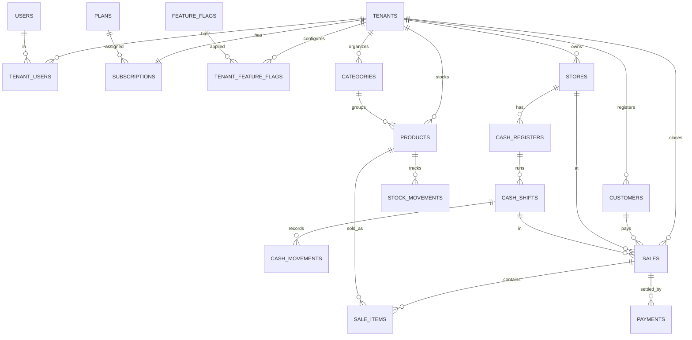

# Database — NinjaSoft POS

> Modelo de datos multi-tenant sobre Postgres (Supabase). Este documento es la referencia técnica de todas las tablas, relaciones, índices y policies.

---

## 1. Principios de diseño

Resumen (ver `docs/01-mvp.md` § 3):

1. **`tenant_id` obligatorio** en toda tabla operativa, con FK a `tenants(id)` y RLS activa.
2. **UUID v4** en todas las primary keys (`gen_random_uuid()`).
3. **Timestamps universales:** `created_at`, `updated_at`, `created_by`, `updated_by`.
4. **Baja lógica** con `deleted_at`.
5. **Auditoría automática** con triggers en tablas críticas.

---

## 2. Función `current_tenant_id()`

Función fundamental que extrae el tenant del JWT del usuario. Toda RLS la usa.

```sql
create or replace function current_tenant_id()
returns uuid
language sql stable
as $$
  select coalesce(
    (auth.jwt() -> 'app_metadata' ->> 'current_tenant_id')::uuid,
    null
  )
$$;
```

El `tenant_id` activo se guarda en `app_metadata.current_tenant_id` después de elegir tenant. Esta decisión está registrada en ADR-009.

---

## 3. Triggers globales

### 3.1. `set_updated_at`

```sql
create or replace function set_updated_at()
returns trigger language plpgsql as $$
begin new.updated_at = now(); return new; end;
$$;
```

Aplicar a toda tabla mutable.

### 3.2. `write_audit_log`

Trigger genérico que registra cambios en `audit_logs`:

```sql
create or replace function write_audit_log()
returns trigger language plpgsql as $$
begin
  insert into audit_logs (
    tenant_id, actor_user_id, entity_type, entity_id, action,
    before_data, after_data
  )
  values (
    coalesce(new.tenant_id, old.tenant_id),
    (auth.jwt() ->> 'sub')::uuid,
    tg_table_name,
    coalesce(new.id, old.id),
    tg_op,
    case when tg_op in ('UPDATE','DELETE') then to_jsonb(old) else null end,
    case when tg_op in ('INSERT','UPDATE') then to_jsonb(new) else null end
  );
  return coalesce(new, old);
end;
$$;
```

Aplicar a tablas críticas: `sales`, `payments`, `cash_shifts`, `subscriptions`, `tenant_users`, `tenant_feature_flags`, `users`.

---

## 4. Tablas del MVP

### 4.1. Globales del SaaS (sin `tenant_id`)

#### `tenants`

```sql
create table tenants (
  id           uuid primary key default gen_random_uuid(),
  name         text not null,
  slug         text not null unique,
  cuit         text,
  industry     text check (industry in ('kiosco','textil','retail','restaurante','pyme','otro')),
  country      text not null default 'AR',
  status       text not null default 'trial' check (status in ('trial','active','past_due','suspended','cancelled')),
  trial_ends_at timestamptz,
  created_at   timestamptz not null default now(),
  updated_at   timestamptz not null default now(),
  deleted_at   timestamptz
);

create index tenants_status_idx on tenants(status);
create index tenants_slug_idx on tenants(slug);
```

#### `plans`

```sql
create table plans (
  id           uuid primary key default gen_random_uuid(),
  key          text not null unique check (key in ('start','pro','business','enterprise')),
  name         text not null,
  description  text,
  monthly_price_ars numeric(12,2) not null,
  yearly_price_ars  numeric(12,2),
  limits       jsonb not null default '{}'::jsonb,
  is_active    boolean not null default true,
  created_at   timestamptz default now()
);
```

`limits` ejemplo:
```json
{ "stores": 3, "users": 10, "sales_per_month": 50000 }
```

#### `feature_flags`

```sql
create table feature_flags (
  id              uuid primary key default gen_random_uuid(),
  key             text not null unique,
  description     text,
  default_enabled boolean not null default false,
  created_at      timestamptz default now()
);
```

Ejemplos de keys: `afip_enabled`, `multi_store`, `promotions_v2`, `barcode_scanner`, `csv_import`.

#### `system_settings`

```sql
create table system_settings (
  key   text primary key,
  value jsonb not null,
  updated_at timestamptz default now()
);
```

#### `users`

Manejada por Supabase Auth en `auth.users`. Tabla espejo en `public.users` para datos públicos:

```sql
create table public.users (
  id          uuid primary key references auth.users(id) on delete cascade,
  email       text not null unique,
  full_name   text,
  avatar_url  text,
  locale      text default 'es-AR',
  is_internal boolean not null default false,  -- staff NinjaSoft
  created_at  timestamptz default now(),
  updated_at  timestamptz default now()
);
```

#### `audit_logs`

```sql
create table audit_logs (
  id             uuid primary key default gen_random_uuid(),
  tenant_id      uuid,
  actor_user_id  uuid,
  entity_type    text not null,
  entity_id      uuid,
  action         text not null,  -- INSERT, UPDATE, DELETE, custom (sale_voided, plan_changed...)
  before_data    jsonb,
  after_data     jsonb,
  reason         text,
  ip_address     inet,
  user_agent     text,
  created_at     timestamptz not null default now()
);

create index audit_logs_tenant_idx on audit_logs(tenant_id, created_at desc);
create index audit_logs_entity_idx on audit_logs(entity_type, entity_id);
create index audit_logs_actor_idx on audit_logs(actor_user_id, created_at desc);
```

`audit_logs` es **append-only**: no se permite UPDATE ni DELETE (excepto para retención programada).

### 4.2. Relaciones tenant ↔ usuarios

#### `tenant_users`

```sql
create table tenant_users (
  id         uuid primary key default gen_random_uuid(),
  tenant_id  uuid not null references tenants(id) on delete cascade,
  user_id    uuid not null references users(id) on delete cascade,
  role       text not null check (role in ('owner','manager','cashier','viewer')),
  status     text not null default 'active' check (status in ('active','suspended','invited')),
  invited_at timestamptz,
  joined_at  timestamptz,
  created_at timestamptz default now(),
  updated_at timestamptz default now(),
  unique(tenant_id, user_id)
);

create index tenant_users_user_idx on tenant_users(user_id);
create index tenant_users_tenant_idx on tenant_users(tenant_id);
```

#### `subscriptions`

```sql
create table subscriptions (
  id             uuid primary key default gen_random_uuid(),
  tenant_id      uuid not null references tenants(id) on delete cascade unique,
  plan_id        uuid not null references plans(id),
  status         text not null check (status in ('trial','active','past_due','suspended','cancelled')),
  billing_cycle  text not null default 'monthly' check (billing_cycle in ('monthly','yearly')),
  current_period_start timestamptz,
  current_period_end   timestamptz,
  cancel_at_period_end boolean default false,
  created_at     timestamptz default now(),
  updated_at     timestamptz default now()
);
```

#### `tenant_feature_flags`

```sql
create table tenant_feature_flags (
  id              uuid primary key default gen_random_uuid(),
  tenant_id       uuid not null references tenants(id) on delete cascade,
  feature_flag_id uuid not null references feature_flags(id) on delete cascade,
  enabled         boolean not null,
  configured_by   uuid references users(id),
  configured_at   timestamptz default now(),
  unique(tenant_id, feature_flag_id)
);
```

### 4.3. Operativas del tenant

#### `stores` (sucursales)

```sql
create table stores (
  id         uuid primary key default gen_random_uuid(),
  tenant_id  uuid not null references tenants(id),
  name       text not null,
  address    text,
  phone      text,
  is_default boolean default false,
  is_active  boolean default true,
  created_at timestamptz default now(),
  updated_at timestamptz default now(),
  deleted_at timestamptz
);
```

#### `cash_registers` (cajas)

```sql
create table cash_registers (
  id         uuid primary key default gen_random_uuid(),
  tenant_id  uuid not null references tenants(id),
  store_id   uuid not null references stores(id),
  name       text not null,
  is_active  boolean default true,
  created_at timestamptz default now(),
  updated_at timestamptz default now()
);
```

#### Extensión F17 · H89-H91 (ADR-045): sucursales, cajas y personal por sucursal

Migraciones `20261013100000_sucursales_cajas`, `20261013110000_personal_por_sucursal` y `20261013120000_venta_sucursal_del_turno`.

- `stores` suma `code` (único vivo por negocio, en mayúsculas), `short_name`, `color` (`#rrggbb`), `email`, `city`, `province`, `postal_code`, `timezone`, `afip_pos_number` (PV ARCA, 1 a 99998), `opening_hours` (jsonb `{ mon: [{from, to}], ... }`), `notes`, `sort`, `archived_reason`. Estados: activa, pausada (`is_active = false`) y archivada (`deleted_at`). Una sola principal viva por negocio (índice parcial; cambiar con `set_default_store`).
- `cash_registers` suma `code` (único vivo por sucursal), `kind` (`fixed`, `mobile`, `self_service`), `device_notes`, `printer_notes`, `afip_pos_number`, `sort`, `deleted_at`, `archived_reason`.
- `cash_shifts.store_id` (not null): desnormalizado de la caja por trigger; es histórico (mover la caja no lo cambia).
- Triggers `stores_enforce_rules` y `cash_registers_enforce_rules`: feature y límite del plan al crear o restaurar (`multi_sucursal` + `max_stores`; `multi_caja` + `max_registers_per_store`), y reglas de archivo y pausa (principal, turno abierto, última sucursal activa, última caja).
- `staff_branch_assignments(store_id, user_id | cashier_profile_id, kind home|cover|extra, role, valid_from, valid_until, reason, transfer_id, superseded_by, prev_valid_until, deleted_at, cancel_reason)`: personal por sucursal con vigencias. Escritura sólo por `staff_branch_schedule` y `staff_branch_cancel`.
- Helpers: `branch_today()`, `staff_allowed_store_ids(...)`, `user_allowed_store_ids()`, `user_can_access_store(store)`, `user_store_role(store)`, `tenant_limit_for(tenant, key)`, `resolve_sale_shift(shift, strict)`.
- RLS: lectura de `stores` y `cash_registers` para miembros, escritura owner/manager, sin DELETE. Policies RESTRICTIVE de lectura por sucursal en `sales`, `cash_shifts`, `cash_movements` y `cash_z_closures`.

#### `categories`

```sql
create table categories (
  id          uuid primary key default gen_random_uuid(),
  tenant_id   uuid not null references tenants(id),
  parent_id   uuid references categories(id),
  name        text not null,
  sort_order  int default 0,
  is_active   boolean default true,
  created_at  timestamptz default now(),
  updated_at  timestamptz default now(),
  deleted_at  timestamptz
);
```

#### `products`

```sql
create table products (
  id              uuid primary key default gen_random_uuid(),
  tenant_id       uuid not null references tenants(id),
  category_id     uuid references categories(id),
  sku             text,
  barcode         text,
  name            text not null,
  description     text,
  price           numeric(12,2) not null check (price >= 0),
  cost            numeric(12,2),
  stock           numeric(12,3) not null default 0,
  stock_min       numeric(12,3) default 0,
  unit            text default 'un',  -- un, kg, lt, etc.
  image_url       text,
  is_active       boolean default true,
  metadata        jsonb default '{}'::jsonb,
  created_at      timestamptz default now(),
  updated_at      timestamptz default now(),
  created_by      uuid references users(id),
  updated_by      uuid references users(id),
  deleted_at      timestamptz
);

create unique index products_tenant_sku_idx on products(tenant_id, sku) where sku is not null and deleted_at is null;
create unique index products_tenant_barcode_idx on products(tenant_id, barcode) where barcode is not null and deleted_at is null;
create index products_tenant_name_idx on products(tenant_id, name);
create index products_category_idx on products(category_id);
```

#### `stock_movements`

```sql
create table stock_movements (
  id          uuid primary key default gen_random_uuid(),
  tenant_id   uuid not null references tenants(id),
  product_id  uuid not null references products(id),
  store_id    uuid references stores(id),
  delta       numeric(12,3) not null,  -- positivo = ingreso, negativo = egreso
  reason      text not null check (reason in ('purchase','sale','sale_void','adjustment','transfer','loss','return')),
  reference_id uuid,                   -- id de la venta, ajuste, etc.
  notes       text,
  created_at  timestamptz default now(),
  created_by  uuid references users(id)
);

create index stock_movements_product_idx on stock_movements(product_id, created_at desc);
create index stock_movements_tenant_idx on stock_movements(tenant_id, created_at desc);
```

#### `customers`

```sql
create table customers (
  id              uuid primary key default gen_random_uuid(),
  tenant_id       uuid not null references tenants(id),
  name            text not null,
  document_type   text check (document_type in ('cuit','dni','cuil','passport','other')),
  document_number text,
  iva_condition   text check (iva_condition in ('consumidor_final','responsable_inscripto','monotributo','exento','no_responsable')),
  email           text,
  phone           text,
  address         text,
  notes           text,
  is_active       boolean default true,
  metadata        jsonb default '{}'::jsonb,
  created_at      timestamptz default now(),
  updated_at      timestamptz default now(),
  deleted_at      timestamptz
);

create index customers_tenant_doc_idx on customers(tenant_id, document_number);
create index customers_tenant_name_idx on customers(tenant_id, name);
```

#### `cash_shifts` (turnos de caja)

```sql
create table cash_shifts (
  id                  uuid primary key default gen_random_uuid(),
  tenant_id           uuid not null references tenants(id),
  cash_register_id    uuid not null references cash_registers(id),
  opened_by           uuid not null references users(id),
  closed_by           uuid references users(id),
  opened_at           timestamptz not null default now(),
  closed_at           timestamptz,
  opening_amount      numeric(12,2) not null,
  expected_amount     numeric(12,2),
  closing_amount      numeric(12,2),
  difference          numeric(12,2) generated always as (closing_amount - expected_amount) stored,
  status              text not null default 'open' check (status in ('open','closed')),
  notes               text,
  created_at          timestamptz default now(),
  updated_at          timestamptz default now()
);

create index cash_shifts_tenant_idx on cash_shifts(tenant_id, opened_at desc);
create index cash_shifts_register_idx on cash_shifts(cash_register_id, status);
```

#### `cash_movements`

```sql
create table cash_movements (
  id              uuid primary key default gen_random_uuid(),
  tenant_id       uuid not null references tenants(id),
  cash_shift_id   uuid not null references cash_shifts(id),
  type            text not null check (type in ('income','expense','sale','sale_void')),
  amount          numeric(12,2) not null,
  payment_method  text,
  reason          text,
  reference_id    uuid,           -- id de venta cuando aplica
  created_at      timestamptz default now(),
  created_by      uuid references users(id)
);

create index cash_movements_shift_idx on cash_movements(cash_shift_id, created_at);
```

#### `sales`

```sql
create table sales (
  id                uuid primary key default gen_random_uuid(),
  tenant_id         uuid not null references tenants(id),
  store_id          uuid not null references stores(id),
  cash_shift_id     uuid references cash_shifts(id),
  customer_id       uuid references customers(id),
  number            bigint not null,   -- número correlativo por tenant
  status            text not null default 'completed' check (status in ('completed','voided','suspended')),
  subtotal          numeric(12,2) not null,
  discount_total    numeric(12,2) not null default 0,
  tax_total         numeric(12,2) not null default 0,
  total             numeric(12,2) not null,
  notes             text,
  voided_at         timestamptz,
  voided_by         uuid references users(id),
  void_reason       text,
  created_at        timestamptz default now(),
  updated_at        timestamptz default now(),
  created_by        uuid references users(id),
  unique(tenant_id, number)
);

create index sales_tenant_created_idx on sales(tenant_id, created_at desc);
create index sales_shift_idx on sales(cash_shift_id);
create index sales_customer_idx on sales(customer_id);
create index sales_status_idx on sales(tenant_id, status);
```

#### `sale_items`

```sql
create table sale_items (
  id            uuid primary key default gen_random_uuid(),
  tenant_id     uuid not null references tenants(id),
  sale_id       uuid not null references sales(id) on delete cascade,
  product_id    uuid not null references products(id),
  product_name  text not null,     -- snapshot
  sku           text,              -- snapshot
  quantity      numeric(12,3) not null,
  unit_price    numeric(12,2) not null,
  discount      numeric(12,2) not null default 0,
  subtotal      numeric(12,2) not null,
  created_at    timestamptz default now()
);

create index sale_items_sale_idx on sale_items(sale_id);
create index sale_items_product_idx on sale_items(product_id);
```

#### `payments`

```sql
create table payments (
  id            uuid primary key default gen_random_uuid(),
  tenant_id     uuid not null references tenants(id),
  sale_id       uuid not null references sales(id) on delete cascade,
  method        text not null check (method in ('cash','debit','credit','transfer','qr','other')),
  amount        numeric(12,2) not null,
  reference     text,              -- número de cupón, qr, etc.
  metadata      jsonb default '{}'::jsonb,
  created_at    timestamptz default now()
);

create index payments_sale_idx on payments(sale_id);
create index payments_tenant_method_idx on payments(tenant_id, method, created_at desc);
```

Columnas agregadas después (ver migraciones): `card_voucher jsonb` (datos del cupón de tarjeta: `lote`, `cupon`, `autorizacion`, `marca`, `ultimos4`, `comercio`, todos opcionales) y `reconciled_at timestamptz` / `reconciled_by uuid` (conciliación de tarjetas, ADR-044). Las dos de conciliación sólo cambian por la RPC `set_payments_reconciled` (trigger `payments_reconcile_guard` rechaza el UPDATE directo).

La numeración del cupón (`lote`, `cupon`, `autorizacion`, `ultimos4`, `comercio`, `cuotas`) se corrige sólo por la RPC `update_payment_voucher` (dueño o encargado cualquiera; cajero los de sus turnos y pendientes), que deja el historial en `payment_voucher_edits` (`payment_id`, `edited_by` / `edited_by_name`, `edited_at`, `changed_keys`, `before_data`, `after_data`, `was_reconciled`, `as_supervisor`, `reason`; lectura por tenant con `internal_scope()`, sin escritura por PostgREST) y en `audit_logs` (`payment_voucher_updated`). Migración `20261018200000_edicion_cupon_tarjeta`, ADR-044 (adenda).

---

## 5. Diagrama ER simplificado



---

## 6. Reglas de RLS

Patrón estándar aplicado a toda tabla con `tenant_id`:

```sql
alter table <t> enable row level security;

create policy "<t>_select" on <t> for select
  using (tenant_id = current_tenant_id());

create policy "<t>_insert" on <t> for insert
  with check (tenant_id = current_tenant_id());

create policy "<t>_update" on <t> for update
  using (tenant_id = current_tenant_id())
  with check (tenant_id = current_tenant_id());
```

Tablas globales (sin `tenant_id`):

- `tenants`, `plans`, `feature_flags`, `system_settings`: solo lectura para usuarios autenticados, escritura solo via `service_role` (panel interno).
- `users`: cada usuario solo ve y edita su propia fila.
- `audit_logs`: cada tenant ve solo sus logs; INSERT permitido a `service_role` y triggers; UPDATE/DELETE bloqueados.

Documentación detallada por tabla en `supabase/policies/<tabla>.md`.

---

## 7. Datos snapshot en `sale_items`

Las columnas `product_name` y `sku` se copian al crear el item porque el producto puede cambiar después. La venta debe ser **inmutable en su contenido** una vez completada.

---

## 8. Numeración correlativa de ventas

`sales.number` es un correlativo por tenant. Se genera en la Edge Function `create_sale` con `select coalesce(max(number), 0) + 1 from sales where tenant_id = X for update;` dentro de la transacción.

Cuando entre AFIP (Fase 3), se sumará `point_of_sale` y `voucher_number` AFIP.

---

## 8.1 Extensión F12 — servicios y agenda

Cuando entre F12 (comercios simples y servicios), se agregará un bloque de tablas operativas multi-tenant:

- [ ] `service_items`: servicios vendibles sin stock obligatorio, con duración, precio, categoría y comisión default.
- [ ] `appointment_resources`: profesionales, sillas, cabinas o recursos reservables.
- [ ] `appointments`: turno, cliente, profesional/recurso, estado, seña, no-show y notas.
- [ ] `appointment_services`: servicios asociados al turno.
- [ ] `service_sessions`: packs/sesiones vendidas y saldo consumible.
- [ ] `staff_commissions`: comisión calculada por venta/servicio/producto/profesional.
- [ ] `tips`: propinas por venta/profesional/medio de pago.
- [ ] `item_modifiers`: modificadores simples para catálogo chico (tamaño, sabor, topping, extra).

Reglas:

- [ ] Todas las tablas operativas llevan `tenant_id` y RLS estándar.
- [ ] Servicios pueden venderse en `sale_items` como snapshot igual que productos.
- [ ] El stock es opcional para servicios; si un servicio consume insumos, se modela como extensión posterior de inventario/recetas.
- [ ] Cambios de turno, comisión, profesional asignado y packs quedan auditados.

---

## 8.2 Extensión F13 — gastronomía

Cuando entre F13 (gastronomía PRO), se agregará un bloque de tablas operativas multi-tenant para mesas, comandas y cocina:

- [ ] `dining_areas`: salones/sectores (principal, terraza, barra, patio).
- [ ] `dining_tables`: mesas con capacidad, posición, estado y sector.
- [ ] `restaurant_orders`: pedido gastronómico por mesa/mostrador/delivery/takeaway.
- [ ] `restaurant_order_items`: ítems con curso, estación, estado de cocina y snapshot.
- [ ] `order_modifiers`: modificadores gastronómicos por ítem.
- [ ] `kitchen_stations`: cocina, barra, cafetería, heladería, parrilla, postres, despacho.
- [ ] `kitchen_tickets`: comandas enviadas a impresión/KDS.
- [ ] `kitchen_ticket_items`: detalle ruteado por estación.
- [ ] `table_transfers`: movimientos/uniones/transferencias de mesa.
- [ ] `delivery_orders`: datos de canal, dirección, cadete, estado y horario prometido.
- [ ] `recipes` y `recipe_items`: receta/escandallo e insumos.
- [ ] `production_batches`: producción previa y merma básica.

Reglas:

- [ ] Todas las tablas operativas llevan `tenant_id` y RLS estándar.
- [ ] Una venta puede nacer desde `restaurant_orders` y terminar en `sales` al cobrar.
- [ ] Las comandas son append-only: una anulación o cambio posterior genera ticket de corrección, no borra historia.
- [ ] El ruteo a estación debe ser idempotente para evitar doble impresión o doble aparición en KDS.
- [ ] Mover/unir/dividir mesas queda auditado.
- [ ] Si se activa receta/escandallo, el descuento de insumos debe ser idempotente y reversible por anulación.

---

## 8.3 Extensión F7/H12-H13b — planes custom y notificaciones

Cuando se complete la consola internal de suscripciones y notificaciones, se agregará un bloque multi-tenant para monetización flexible:

- [ ] `tenant_plan_overrides`: plan específico por cliente con límites, módulos, soporte, precio, moneda, ciclo y vigencia.
- [ ] `subscription_price_changes`: aumentos/cambios programados con antes/después, fecha efectiva, aviso, aceptación y estado.
- [ ] `billing_events`: pagos, deuda, vencimientos, recibos internos y eventos de cobranza.
- [ ] `account_notifications`: notificaciones in-app por tenant.
- [ ] `account_notification_recipients`: destinatarios por usuario/rol/sucursal y estado de lectura/acción.
- [ ] `notification_delivery_logs`: trazabilidad de email/WhatsApp/push/webhook cuando aplique.

Reglas:

- [ ] Todo plan custom referencia un plan base global.
- [ ] Los overrides son por tenant y nunca modifican el plan base.
- [ ] Aumentos de cuota/precio guardan valor anterior, valor nuevo, fecha efectiva, motivo y actor.
- [ ] Notificaciones críticas se insertan en la misma transacción lógica que el evento que las dispara.
- [ ] RLS: cada tenant ve solo sus notificaciones; internal ve todo con auditoría.
- [ ] Delivery externo de notificaciones se registra, pero el in-app inbox es la fuente mínima garantizada.

---

## 8.4 Extensión F14 — motor comercial enterprise

Cuando entre F14, se agregará un bloque de configuración comercial versionada y auditada:

- [ ] `tenant_entitlements`: permisos efectivos por tenant/modulo/recurso.
- [ ] `tenant_usage_counters`: uso mensual o por periodo para cuotas medibles.
- [ ] `usage_events`: eventos crudos para reconstruir consumo.
- [ ] `plan_addons`: catalogo global de add-ons.
- [ ] `tenant_addons`: add-ons contratados por tenant con vigencia.
- [ ] `pricing_rules`: reglas comerciales de precio/descuento/recargo.
- [ ] `surcharge_rules`: variantes por medio, cuotas, canal, sucursal y vigencia.
- [ ] `commercial_rule_versions`: versiones publicadas/draft/archivadas.
- [ ] `commercial_change_requests`: solicitudes maker-checker con aprobacion.
- [ ] `config_templates`: plantillas por rubro/plan.
- [ ] `config_snapshots`: snapshots para diff y rollback.
- [ ] `billing_ledger`: cargos, creditos, pagos, deuda y vencimientos de NinjaSoft.
- [ ] `supplier_accounts`: proveedores y condiciones.
- [ ] `purchase_orders`: ordenes de compra.
- [ ] `purchase_order_items`: detalle y recepcion parcial.
- [ ] `inventory_lots`: lotes y vencimientos.
- [ ] `inventory_serial_numbers`: numeros de serie y garantia.
- [ ] `stock_counts`: conteos fisicos/ciclicos.
- [ ] `offline_operation_queue`: operaciones generadas offline con `client_operation_id`.
- [ ] `api_clients`: credenciales/scopes de API por tenant.
- [ ] `webhook_subscriptions`: endpoints externos por evento.
- [ ] `webhook_delivery_logs`: entregas, reintentos y errores.

Reglas:

- [ ] Configuracion sensible debe tener version, actor, motivo y estado.
- [ ] Cambios publicados son append-only; rollback crea una nueva version.
- [ ] `tenant_usage_counters` se puede recalcular desde `usage_events`.
- [ ] Offline usa idempotencia por tenant + `client_operation_id`.
- [ ] API/webhooks tienen scopes, rate limit y audit log.

---

## 8.5 Extensión F15 — escuela y onboarding guiado

Cuando entre F15, se agregará un bloque para cursos, tours, sugerencias y certificaciones:

- [ ] `learning_courses`: cursos.
- [ ] `learning_modules`: modulos dentro de cursos.
- [ ] `learning_lessons`: lecciones.
- [ ] `learning_steps`: pasos, recursos y checks.
- [ ] `learning_assessments`: evaluaciones.
- [ ] `learning_progress`: progreso por usuario/tenant.
- [ ] `learning_certifications`: certificaciones disponibles.
- [ ] `user_certifications`: certificaciones obtenidas.
- [ ] `guided_tours`: recorridos guiados.
- [ ] `guided_tour_versions`: version draft/publicada.
- [ ] `guided_tour_steps`: pasos anclados a UI.
- [ ] `onboarding_checklists`: checklist por rubro/plan.
- [ ] `onboarding_tasks`: tareas generadas por tenant.
- [ ] `onboarding_suggestions`: sugerencias/nudges configurables.
- [ ] `suggestion_events`: vistas, clicks, pospuestos, completados.
- [ ] `knowledge_articles`: base de conocimiento contextual.
- [ ] `practice_sandboxes`: laboratorios demo por tenant.

Reglas:

- [ ] El contenido se segmenta por plan, rubro, rol, pais, feature flag y version de producto.
- [ ] Los tours publicados son inmutables; editar crea nueva version.
- [ ] Progreso y certificaciones son por usuario y tenant.
- [ ] Sugerencias respetan cooldown y maximo por sesion/dia.
- [ ] El laboratorio nunca emite AFIP real ni altera stock/caja productivos.

---

## 8.6 Extensión F16 — comercio unificado tipo Napse/TOTVS

Cuando entre F16, se agregará un bloque para OMS, pagos orquestados, fiscal hub, promociones/fidelización enterprise, integraciones y riesgo:

- [ ] `commerce_orders`: orden omnicanal con canal, origen, estado, cliente, totales y referencias externas.
- [ ] `commerce_order_items`: ítems de orden con snapshot, canal, fulfillment y estado.
- [ ] `commerce_reservations`: reservas de stock por canal/sucursal/depósito con expiración.
- [ ] `fulfillment_tasks`: picking, packing, entrega, retiro y tareas de preparación.
- [ ] `fulfillment_shipments`: envíos, retiro en tienda, ship-from-store y tracking.
- [ ] `cross_channel_returns`: devoluciones/cambios entre canales con trazabilidad fiscal/stock/pago.
- [ ] `payment_transactions`: estado único de pagos presenciales, QR, link, e-commerce y marketplace.
- [ ] `payment_reconciliations`: conciliaciones por lote, cupón, autorización, terminal, adquirente y liquidación.
- [ ] `payment_terminal_health`: salud de terminales, caídas, latencia y último heartbeat.
- [ ] `fiscal_documents`: comprobantes fiscales/no fiscales por país/canal/venta/orden.
- [ ] `fiscal_document_files`: XML/PDF/adjuntos con almacenamiento seguro y retención.
- [ ] `promo_campaigns`: campañas omnicanal con presupuesto, vigencia, simulación y estado.
- [ ] `loyalty_accounts`: cuenta de fidelización por cliente.
- [ ] `loyalty_movements`: puntos, cashback, beneficios, vencimientos y canjes.
- [ ] `gift_cards`: gift cards/vales con saldo, vencimiento y riesgo.
- [ ] `customer_wallets`: monedero electrónico/saldo a favor enterprise.
- [ ] `integration_connectors`: conectores por canal/app/ERP/marketplace.
- [ ] `integration_jobs`: jobs de sync con estado, intento, payload hash e idempotencia.
- [ ] `integration_dead_letters`: errores no resueltos con replay manual auditado.
- [ ] `risk_rules`: reglas de riesgo/fraude por tenant/canal.
- [ ] `risk_events`: eventos sospechosos, score, resolución y auditoría.

Reglas:

- [ ] Toda entidad cross-channel lleva `tenant_id`, `source_channel`, `external_reference` e `idempotency_key` cuando aplique.
- [ ] Los conectores nunca escriben directo en tablas críticas sin pasar por comandos idempotentes.
- [ ] Pagos y fiscal tienen estados propios, no se infieren solo desde `sales.status`.
- [ ] Devoluciones cross-channel vinculan orden/venta original, pago, documento fiscal y movimiento de stock.
- [ ] Dead-letter y replay son operaciones auditadas y visibles para soporte.
- [ ] Riesgo/fraude nunca bloquea silenciosamente: debe explicar regla, score y acción requerida.

## 8.7 Extensión F17: stock por sucursal y traslados (ADR-046)

Migraciones `20261013200000` (features), `20261013200100` (stock por sucursal) y `20261013200200` (traslados).

- [x] `product_stock(tenant_id, store_id, product_id, variant_id, qty, min_qty, max_qty, location)`: stock en mano por sucursal, único por `(store_id, product_id, variant_id)` con `nulls not distinct`. Sólo lectura por RLS; el saldo cambia por triggers sobre `stock_movements` y la configuración por RPC (`set_store_stock_settings`).
- [x] `stock_movements.store_id` se completa en `BEFORE INSERT` (venta referenciada o sucursal principal) y `AFTER INSERT/DELETE` aplica el delta a `product_stock`. Motivos nuevos: `production`, `count`, `transfer_out`, `transfer_in`, `transfer_return`.
- [x] Invariante al commit (triggers de restricción diferidos): `products.stock` = Σ `product_stock.qty` (variante null) y `product_variants.stock` = Σ por variante. Una diferencia (edición directa, alta con stock inicial, import) entra como movimiento `adjustment` en la sucursal principal. Diagnóstico: `product_stock_mismatches(tenant)` (service_role).
- [x] `stock_transfers` (remito correlativo `number` por tenant, estados `draft → pending_approval → scheduled → in_transit → partially_received → received / cancelled`), `stock_transfer_items` (pedido, enviado, recibido, motivo de diferencia), `stock_transfer_events` (timeline) y `stock_transfer_settings` (aprobación por unidades o valor, permisos de cajero, sobrantes, motivo obligatorio, bloqueo sin stock). Sólo lectura por RLS (la configuración la escriben owner/manager); todo cambio por RPC `transfer_*` SECURITY DEFINER con `audit_logs`.
- [x] Lecturas: `stock_by_store(product_ids)` (saldo, mínimos y en camino) y `stock_low_by_store(limit)` (faltantes por sucursal con el saldo de todas, para sugerir traslados).
- [ ] RLS por sucursal (`user_can_access_store`) cuando exista H91.

## 8.8 Extensión F8: cobros en espera (ADR-048)

Migración `20261014100000_cobros_en_espera`.

- [x] `pending_charges`: venta estacionada esperando el pago de un QR o link. `tenant_id`, `store_id`, `register_id`, `cash_shift_id` (turno dueño hoy; null = pasado a la próxima apertura), `origin_shift_id`, `created_by`, cliente (`customer_id`, nombre, email, celular), `sale_args` (argumentos de `create_sale`: ítems, extras, descuentos, promo, cupón), `cart` y `lines` (sólo display), `amount` (monto del intent = total + propina autoritativos), `sale_total`, `provider_key`, `channel` (`qr` | `link`), `intent_id` (único, FK `mp_payment_intents`), `previous_intent_ids`, `share_url`, `qr_data`, `shared_via[]`, `share_count`, `status` (`waiting` | `paid` | `completed` | `cancelled` | `expired`), `expires_at`, `paid_at`, `paid_amount`, `completed_at`, `sale_id`, `sale_number`, cancelación, `carry_over`, `needs_review`, `last_error`, `attempts`, `acknowledged_at/by`, `notes`, `version` (edición optimista), timestamps y `deleted_at`.
- [x] `pending_charge_events`: línea de tiempo (`created`, `shared`, `edited`, `regenerated`, `extended`, `updated`, `paid`, `payment_rejected`, `completed`, `completion_failed`, `cancelled`, `expired`, `carried_over`, `attached_to_shift`, `paid_after_cancel`, `old_intent_paid`, `acknowledged`).
- [x] RLS: lectura por negocio y sucursal permitida (`user_allowed_store_ids`); sin policies de escritura. Todo cambio por RPC SECURITY DEFINER con `audit_logs`: `park_pending_charge`, `complete_pending_charge`, `cancel_pending_charge`, `update_pending_charge`, `replace_pending_charge_intent`, `mark_pending_charge_shared`, `ack_pending_charge`. La Edge `pending_charge_share` escribe con service_role (envío de email).
- [x] Venta del lado del servidor: `_pc_complete` (lock del cobro y del intent, idempotente) corre `create_sale` con el carrito guardado, el monto del intent y el turno abierto (el suyo, el de su caja o el de su sucursal), con los claims de la transacción del usuario que estacionó. Disparadores: trigger `AFTER UPDATE OF status` en `mp_payment_intents`, trigger `AFTER INSERT` en `cash_shifts` (enganche y reintentos al abrir caja), cron `pending-charges-tick` (vencimiento y reintentos) y el POS.
- [x] `close_cash_shift(p_shift_id, p_closing_amount, p_notes, p_pending_action)`: con cobros abiertos en el turno exige `cancel` o `carry` (se dropea la firma de 3 args).
- [x] `notifications.type` suma `cobros`; `system_emails.kind` suma `payment_link`.

## 8.9 Extensión F18: compras, proveedores, costos e importaciones (ADR-050)

Migraciones `20261016100000` (features `compras` y `compras_importacion`), `20261016100100` (costos, configuración, proveedores), `20261016100200` (órdenes, recepciones, lotes, costeo, sugerencia) y `20261016100300` (comprobantes, pagos, cuenta corriente). Lectura: `tenant_id = current_tenant_id() or internal_scope()` (ADR-052).

- [x] `products.last_cost`, `avg_cost`, `replacement_cost`, `cost_updated_at` (netos de IVA, en pesos) y `product_cost_history` (por trigger `products_cost_track`, con la fuente). Con `purchase_settings.sync_product_cost`, `products.cost` sigue a la base elegida (`cost_basis`: last, average, replacement).
- [x] `purchase_settings` (pk `tenant_id`): modo simple o profesional, base de costo, reglas de recepción, moneda habitual. Escritura por RPC `purchase_settings_save`.
- [x] `suppliers` (CUIT único por negocio entre los vigentes, check `cuit_is_valid`, CBU 22 dígitos, alias, baja lógica) y `supplier_products` (único por proveedor, producto y variante vigentes). Escritura por tabla: owner/manager y feature `compras` (`purchase_can_write()`); auditoría con `write_audit_log`.
- [x] `purchase_orders` (`number` correlativo, estados `draft → sent → partially_received → received / cancelled`, moneda y TC, descuento global, totales) y `purchase_order_items` (`discounts numeric[]` en cascada, `line_net`). RPC `purchase_order_save | _send | _reopen | _cancel | _close`.
- [x] `goods_receipts` (`number`, OC opcional, sucursal, remito, moneda y TC, `costing` jsonb, `landed_total`, `dispatch_number`, `invoice_id`) y `goods_receipt_items` (esperado, recibido, motivo de diferencia, costo en moneda, en pesos, puesto en depósito y `valued_unit_cost`, peso, volumen, lote, vencimiento). RPC `purchase_receive` (stock + `stock_movements` `purchase` con `store_id`, último costo, promedio ponderado, `supplier_products`) y `purchase_apply_costing` (`compras_importacion`).
- [x] `product_lots` (lote de ingreso con n° de despacho, vencimiento y costo). Sin consumo por lote todavía.
- [x] `purchase_events` (timeline de órdenes, recepciones, comprobantes y pagos) + `audit_logs` en cada RPC.
- [x] `supplier_invoices` (factura, ND, NC; letra, PV y número únicos entre vigentes; `vat_lines` y `other_taxes` jsonb; anulación con motivo) y `supplier_payments` (`number`, medio, referencia, retenciones jsonb, `amount = net_paid + withholdings_total`). RPC `supplier_invoice_save | _void`, `supplier_payment_create | _void`.
- [x] Vistas `supplier_account_entries` y `supplier_balances` (`security_invoker`): saldo en pesos al TC de cada documento.
- [x] `purchase_suggestions(store, supplier, limit)` (SECURITY INVOKER): faltantes bajo el mínimo contando traslados en camino y OC abiertas.

## 8.10 Extensión F17: configuración heredable, terminales, impresoras y reportes por sucursal (ADR-049)

Migraciones `20261015100000_config_heredable`, `20261015110000_terminales_cobro`, `20261015120000_venta_config_efectiva`, `20261015130000_impresoras_marca_sucursal`, `20261015200000_reportes_por_sucursal` y `20261015300000_personal_tickets_auditoria_sucursal`.

- [x] `store_groups(tenant_id, name, color, sort, deleted_at)` y `stores.store_group_id`: zona o región, nivel de herencia entre el negocio y la sucursal. RLS lectura miembros, escritura owner/manager (alta con `multi_sucursal`). Auditada.
- [x] `config_overrides(tenant_id, scope, scope_id, domain, domain_key, patch, updated_by, deleted_at)`: override **por campo** (`patch` parcial) por alcance `store_group` / `store` / `register` y dominio `payment_method` (clave = `provider_key`), `pos_settings` o `ticket`. Único vivo por `(tenant_id, scope, scope_id, domain, domain_key)`. RLS sólo lectura; escritura únicamente por RPC.
- [x] Whitelist `config_field_type(domain, scope, field)` + validación `config_field_error`. Medios: `enabled` (también caja), `surcharge_pct`, `plan_mode`, `merchant_numbers` (mapa), `sort`. POS: redondeo, venta sin stock, descuento máximo por rol (mapa), cliente obligatorio, cupón de tarjeta, garantía, recibo por mail y, también por caja, venta libre, cierre ciego, tolerancia, motivo de cierre, display de cliente, `print_profiles` y `pos_layout` (mapas). Ticket (grupo y sucursal): razón social, CUIT, teléfono, dirección, título, leyenda, pie y `use_store_contact`.
- [x] Resolución: `_effective_config(tenant, domain, key, store, register)` (service_role, triggers) y `effective_config(domain, key, store, register)` (JWT, valida sucursal del negocio y `user_can_access_store`) → `{ value, sources }`. Orden negocio ← grupo ← sucursal ← caja; mapas mezclados por clave; sin `multi_sucursal` no aplican grupo ni sucursal, sin `multi_caja` no aplica la caja. Espejo puro en `lib/config/inheritance.ts`.
- [x] RPC `config_override_set` (campos y "volver a heredar"), `config_override_copy` (copiar de otra sucursal, `replace` / `merge`) y `config_override_reset_field` ("aplicar a todas"): owner/manager con acceso a la sucursal (grupo exige alcance central), gating `multi_sucursal` / `multi_caja`, `payment_method_plan_key` antes de prender un medio, `audit_logs`.
- [x] Enforcement: trigger `payments_branch_method` (medio apagado por override en la sucursal o caja de la venta → `payment_method_disabled_in_store`, vía `payment_method_blocked_at`). `create_sale` y `close_cash_shift` leen la configuración efectiva del turno (`_pos_close_config`); con `stock_sucursales` y 2+ sucursales, sin venta en negativo también se controla el saldo de la sucursal (`insufficient_stock_branch`).
- [x] `payment_terminals(tenant_id, store_id, cash_register_id, provider_key, kind point|qr_caja|clover|posnet_manual, external_id, external_meta, environment, label, merchant_number, acquirer, is_default, active, last_seen_at, notes, deleted_at)`. Único por `(tenant_id, provider_key, environment, external_id)` vivo y un default por `(cash_register_id, provider_key)`. Trigger de reglas (caja de la sucursal, tipo coherente con el proveedor). RLS lectura por `user_allowed_store_ids()`, escritura owner/manager con acceso a la sucursal; auditada. `terminal_for_user(tenant, user, terminal, store)` (service_role) para las Edges. `mp_payment_intents.payment_terminal_id`. Backfill de `config.mp_qr`, `point_pos_ids` de Nave y `device_serials` de Clover a terminales flotantes de la sucursal principal (lo viejo no se borra).
- [x] `printers(tenant_id, store_id, cash_register_id, name, kind thermal_58|thermal_80|a4|label|kitchen, connection, address, active, notes, last_test_at, last_test_ok, deleted_at)` con la misma RLS que las terminales y `printer_mark_test(printer, ok)`. Los perfiles por documento (`print_profiles`, ahora con `kitchen` y `transfer`) suman `printer_id` y `fallback_printer_id` y se heredan con `config_overrides`.
- [x] `stores.logo_path` / `logo_url` (logo propio opcional, bucket `tenant-assets/<tenant>/stores/<store>/`).
- [x] Reportes: `report_store_filter(p_store_id)` y `p_store_id` opcional en `sales_report`, `staff_productivity` y `gastro_*_report`; `register_stock_waste` con sucursal.
- [x] `audit_logs.store_id` completado por el trigger `audit_logs_fill_store` (fila de `stores` o `store_id` del dato), índice `(tenant_id, store_id, created_at desc)`. `staff_assign_on_invite(...)` (service_role) para invitar con sucursales.
- [x] Políticas nuevas con `internal_scope()` (nunca `or is_internal()`, ADR-052).

---

## 9. Migraciones iniciales sugeridas

Orden recomendado de migraciones para el Hito 0:

1. `00001_extensions.sql` — `pgcrypto`, etc.
2. `00002_functions_helpers.sql` — `current_tenant_id`, `set_updated_at`, `write_audit_log`.
3. `00003_users_and_tenants.sql` — `tenants`, `users`, `tenant_users`.
4. `00004_plans_and_subscriptions.sql` — `plans`, `subscriptions`.
5. `00005_feature_flags.sql` — `feature_flags`, `tenant_feature_flags`.
6. `00006_audit_logs.sql`.
7. `00007_rls_globals.sql` — RLS para tablas globales.
8. `00008_stores_and_registers.sql`.
9. `00009_catalog.sql` — `categories`, `products`, `stock_movements`.
10. `00010_customers.sql`.
11. `00011_cash_shifts.sql` + `cash_movements`.
12. `00012_sales.sql` + `sale_items` + `payments`.
13. `00013_rls_operational.sql` — RLS para todas las tablas operativas.
14. `00014_audit_triggers.sql` — triggers en tablas críticas.
15. `00015_indexes_performance.sql` — índices finales.

Cada una a entregar por el agente `supabase-architect`.

---

## 10. Convenciones generales

- Nombres de tablas: **snake_case plural** (`products`, `cash_shifts`).
- Columnas: **snake_case** (`created_at`, `tenant_id`).
- Foreign keys: `<entidad>_id`.
- Booleans: prefijo `is_` o `has_` (`is_active`, `has_inventory`).
- Estados: columna `status` con `CHECK` constraint, valores en minúsculas y `snake_case`.
- Dinero: `numeric(12,2)` para ARS, `numeric(12,3)` para cantidades fraccionarias.
- Fechas: `timestamptz` siempre (UTC).
